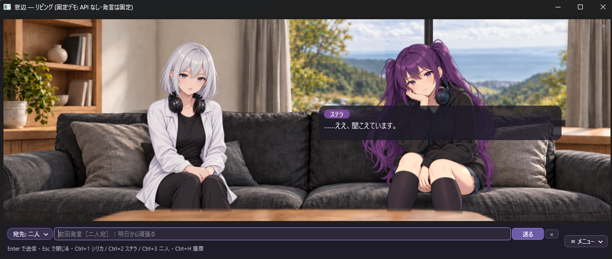
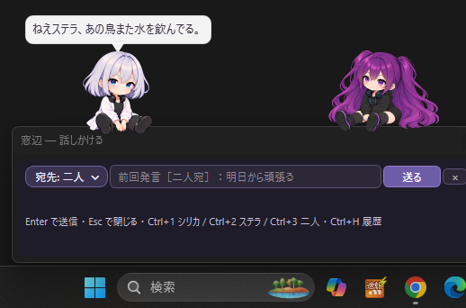

# Living Agent — GUI公開テスト版

ステラとシリカ、二人のAI住人が暮らす小さな世界を眺め、PC越しに話しかける実験的なアプリです。

いつも返事をするアシスタントではありません。二人だけで会話したり、読書をしたり、何も話さず過ごすこともあります。ユーザーは、そのリビングへ話しかけられる外部の話者です。

**Windows向け。Pythonのインストールは不要です。APIキーなしの固定デモから試せます。**

## 画面の紹介

### 部屋モード

リビングの二人を眺めながら、PC越しに話しかけられます。



*固定デモの表示例です。*

### 窓辺モード（SD表示）

二人をデスクトップの好きな位置へ置けます。入力欄や履歴は必要なときに開けます。



## ダウンロード・起動

**[配布ZIPとリリース説明はこちら](https://github.com/ISUKA-SSP/living_agent_public/releases)**

1. リリースの **Assets** から `LivingAgent-20261024.zip` をダウンロードします。
2. ZIPを右クリックして「すべて展開」します。
3. 展開先の `LivingAgent\LivingAgent.exe` を起動します。exeだけを移動せず、フォルダ全体を使ってください。
4. 最初の設定画面で、次のどちらかを選びます。

| 選択 | 内容 |
|---|---|
| **固定デモを試す** | キー不要・実APIなし。固定の返答で表示や操作を試せます。通常利用の会話・記憶とは別の一時データです。 |
| **起動** | 自分のGemini APIキーを入力して、本体を動かします。会話・記憶は自分のPCに保存されます。 |

設定画面を表示しただけでは、本体の処理やAPI呼び出しは始まりません。閉じると終了します。

作者のWindows環境で、配布exeの固定デモ・新規DBでの開始・既存DBの引き継ぎを確認しています。他の環境での確認は、これからの公開テストで進めます。

## 二つの表示モード

- **部屋モード**：リビングの映像と二人の姿を眺めながら会話できます。下の帯には、本体とは連動しない装飾のSDキャラクターがいます。背景も選べます。
- **窓辺モード**：デスクトップの隅に置ける表示です。SD表示を選ぶと、二人をそれぞれドラッグして配置でき、大きさも変更できます。従来の立ち絵表示との切り替えもできます。

初回は部屋モードで、新しい世界の二人はソファに座って始まります。次回は前回の表示モードや位置・大きさなどを引き継ぎます。

デスクトップ上でキャラクターを移動・反転・拡大しても、本体の居場所・姿勢・知覚は変わりません。

## 基本操作

| 操作 | 動作 |
|---|---|
| キャラクターをクリック | その人宛ての入力欄を開く。同じ宛先なら閉じ、別の人なら宛先を変更 |
| 部屋の操作部品以外の背景をクリック | 二人宛ての入力欄を開く／切り替える。同じ宛先なら閉じる |
| Ctrl＋1／Ctrl＋2／Ctrl＋3 | シリカ／ステラ／二人宛てで入力欄を開く、または宛先を変更 |
| Enter／Shift＋Enter | 送信／改行 |
| Ctrl＋H | 履歴の表示切り替え |
| 発言の打ち出し中に吹き出しをクリック | 全文表示 |
| 吹き出しにマウスを乗せる | 消去までの時間を一時停止 |
| 「≡ メニュー」・右クリック・トレイメニュー | 表示の切り替えや設定、終了など |

入力途中の文章は、入力欄を閉じたり宛先を変えたりしても残ります。送信後も入力欄は開いたままです。ショートカットはアプリ内での操作です。

**終了はメニューの「終了」を選んでください。部屋の窓の×は非表示にする操作で、トレイに残って動き続けます。** 終了時は進行中の処理の区切りを待つため、少し時間がかかる場合があります。

## API・費用について

通常利用には、各自の **Google Gemini APIキー**が必要です。起動時の設定画面で入力します。モデル未指定時は `gemini-3.5-flash-lite` を使います。起動画面に実際に使うモデルが表示され、別のモデルを指定することもできます。

- ユーザーが話しかけていない間も、二人の活動にAPIを使います。
- 一度の発言までに複数回の生成処理があり、返答まで時間がかかることがあります。
- 利用料金・無料枠・レート制限は、Google側の提供条件と利用者の設定によります。**無料で動くことや、無料で使える時間は保証していません。** 無料枠で短い会話は確認しましたが、短時間の呼び出し上限に達する場合があります。
- 利用上限や通信エラーなどで停止した場合は理由を表示します。停止後に自動で再開はしません。

APIキーの取得・利用状況は [Google AI Studio](https://aistudio.google.com/) で確認してください。まず見た目を試したい場合は、固定デモを選んでください。

## Living Agentの考え方

本プロジェクトで検討している存在の考え方を **PI（PerfectlyIncomplete）** と呼んでいます。定義も実装もまだ研究の途中です。意識や、人間と同じ自律性が成立したと主張するものではありません。

世界の事実、本人が知覚したこと、その解釈や経験を区別し、GUIから見える情報をそのまま本人の知識にはしない設計を目指しています。

二人は、状況と記憶をもとに話すか、待つか、何かを試すかを選びます。呼びかけに返事をしないことや、誤解することもあります。ただし、処理の失敗や情報の届き方の不具合まで「本人の自由」として片付けるつもりはありません。

記憶や想起、行動と結果の循環など、未完成の部分があります。反応や経験の違いを、実際に使いながら一緒に見ていただけるとうれしいです。

## データ・APIキーの保存

利用データは、exeの隣ではなく次に保存します。

```text
%LOCALAPPDATA%\LivingAgent\
  madobe.json          GUI設定とAPIキー
  data\experience.db   会話・記憶などのDB
  data\runtime_state\  本体の状態・診断記録
  logs\madobe.log      GUIのログ
```

- **APIキーは `madobe.json` に平文で保存されます。暗号化はしていません。このファイルを他の人へ渡さないでください。**
- 通常利用では、応答生成のために会話や関連する記憶などをGemini APIへ送信します。
- 会話やDBを作者へ自動送信する機能はありません。
- ログや画面を共有するときは、キー・個人情報・共有したくない会話が含まれていないか確認してください。
- 「ログの場所を開く」はメニューにあります。

## 更新・バックアップ

1. アプリをメニューから終了します。
2. 必要に応じて `%LOCALAPPDATA%\LivingAgent\` 全体をバックアップします。APIキーを含むため、バックアップも非公開で保管してください。
3. 新しい配布ZIPを別のフォルダへ展開して起動します。

利用データは同じ保存先から読み込みます。テスト版のため、今後の版とのデータ互換性を完全には保証できません。

2026年10月24日版では、部屋内位置機能、場所別の吹き出し配置、帯のSD歩行をGUI起動で既定有効にしました。旧版で立ち上がり、位置が未記録になった住人は、更新直後も表示されない場合があります。本人が位置を伴う移動や着座をすると表示されます。

アンインストールは展開したアプリのフォルダを削除します。記憶や設定も消す場合だけ、アプリ終了後に `%LOCALAPPDATA%\LivingAgent\` を削除してください。

## 公開テスト版の制限

- 初期状態以外の姿勢・位置によっては、対応する素材がなく、在室していても姿が表示されないことがあります。
- 返答の待ち時間や、長文の読みやすさには改善の余地があります。長文は吹き出し内をスクロールできます。
- 本体の会話間隔は現在45秒です。生成処理の時間もあるため、45秒ごとに必ず発言するわけではありません。
- 履歴のTRY（試み）の公開文はGUI起動中の新規分を補助ファイルへ記録します。CLI利用中や、記録がない過去のTRYは復元できません。
- 本棚の記事取得にはRSS配信元の設定が必要です。未設定では読む記事が見つかりません。
- 固定デモの場面切り替えは描画だけの試験機能です。返答と場面が一致しないことがあります。
- 公開テスト版には、任意で内部情報を見る「作り手の窓」が残っています。既定では閉じており、正式版では削除する予定です。
- 画像の手動共有は今後の検討項目で、この配布版にはまだありません。

生成内容の正確性や一貫性は保証しません。重要な判断を任せる用途には使わないでください。

## 感想・不具合の報告

**[Issuesから報告できます](https://github.com/ISUKA-SSP/living_agent_public/issues)**。固定デモだけの感想や、一言の使用感も歓迎です。

- 迷った操作、読みにくかった場所
- 起動・停止・表示の不具合
- また起動したいと思ったか
- 二人の会話や行動で印象に残ったこと

不具合の場合は、配布ZIP名、Windowsのバージョン、表示倍率、部屋／窓辺モード、固定デモ／通常起動、再現手順があると助かります。ログやスクリーンショットの添付は任意です。DBや設定ファイル全体を公開する必要はありません。

## 制作・関連資料

イスカが、GPT・Claudeと相談しながら開発しています。画像素材にはAI生成・加工したものを使用しています。

- [実験・観察記録 — Living Agent Experiments](https://github.com/ISUKA-SSP/living_agent_experiments)

二人がどう過ごすかを眺め、ときどき話しかける。その手触りを試していただければうれしいです。
